<h1 align="center">
  Hi, I'm Venshine 👋
</h1>

  

<!-- STATS-START -->

  
  
  
  

<!-- STATS-END -->

  
  

---

<picture>
  <source media="(prefers-color-scheme: dark)" srcset="assets/hero-dark.svg">
  
</picture>
